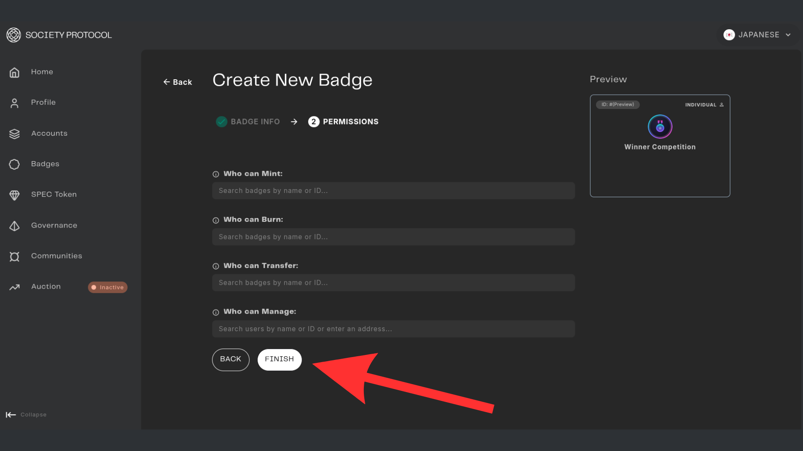

# Create a Badge

This guide explains how to deploy custom ERC-1155 badges using the Web3 Outpost interface.

## Prerequisites
You need to have a personal account in the Web3 Outpost.

## Step-by-Step Guide

Once you mint your Identity, you can go to the badge section on the left side and start the process of badge creation.

### Step 1

### Step 2

### Step 3

### Step 4

### Step 5

